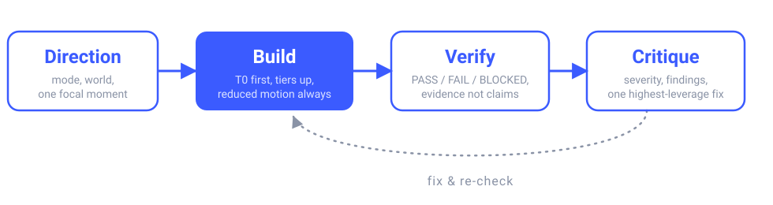

<p align="center">
  
</p>

<p align="center">
  
  
  
</p>

# kinetic-ui

A universal [Agent Skill](https://agentskills.io) for distinctive, accessible, device-aware frontend UX/UI. It runs a full loop so the agent decides what the interface should be, builds it with motion tiers and reduced-motion fallbacks, proves it with a verification matrix, and judges the rendered result:

<p align="center">
  
</p>

Works with any agent that reads the agent-skills format (OpenCode, Claude Code, and others). No runtime, no dependencies, no build step: plain Markdown, CSS, and vanilla JS.

## What it solves

Most UI work fails in the same three places: motion that ignores `prefers-reduced-motion`, effects that melt low-end phones, and visual direction that defaults to the same generic landing page. This skill makes the agent answer all three before writing code:

- **Reduced motion is not optional.** Every effect and component file carries a `## Reduced motion` section with its exact tier-0 behavior, enforced by the validator.
- **Every effect has a budget.** Motion tiers T0–T3 (`references/foundations/performance-tiers.md`) decide what runs on a low-end phone, and each file states its `## Low-end fallback`.
- **Brand first, style second.** A provided brand maps into nine `--brand-*` tokens; with no brand, the agent proposes a style from page type and intended emotion, and labels it a proposal.
- **Direction before code, critique after it.** A short brief fixes the surface mode, visual world, and focal motion moment; the critique scores the rendered result and reports located findings by severity.
- **Verification is a report, not a claim.** A matrix of checks — keyboard, screen reader, contrast, reduced motion, tiers, LCP/INP/CLS, zoom — each with a PASS/FAIL/BLOCKED result and evidence, plus a console audit you can run.

## Install

The skill is the folder `skills/kinetic-ui/`; it is self-contained and needs no runtime. The repository ships an installer for convenience (Node 18+), but copying the folder by hand works too.

```bash
git clone https://github.com/IsCubo/Kinetic-UI.git kinetic-ui
cd kinetic-ui

node scripts/install.mjs --agent opencode   # ~/.config/opencode/skills/kinetic-ui
node scripts/install.mjs --agent claude     # ~/.claude/skills/kinetic-ui
node scripts/install.mjs --agent agents     # ~/.agents/skills/kinetic-ui (shared; OpenCode reads it)
```

Project scope and other agents:

```bash
node scripts/install.mjs --agent opencode --scope project --project ../my-app
node scripts/install.mjs --agent claude --scope project --project ../my-app
node scripts/install.mjs --dest /opt/company-skills          # any agent with a skills directory
```

The installer **copies** by default, so the installed skill keeps working if you move or delete the clone. Add `--link` only if you maintain the skill and want live edits; on Windows it creates a junction, which needs no administrator rights. It refuses to overwrite an existing install unless you pass `--force`, and `--dry-run` prints the target without writing.

Manual install: copy `skills/kinetic-ui/` into the skills folder your agent reads. The maintainer folders (`scripts/`, `tests/`, `docs/`, `odd/`) are not needed at runtime.

OpenCode can also read the clone in place, with no copy and no symlink:

```jsonc
{
  "skills": ["~/projects/kinetic-ui/skills"]
}
```

`~/` resolves against the home directory of whoever runs OpenCode, so the path is portable and nothing points at the maintainer's machine.

## Use

Ask for the outcome, not the file. The skill activates on frontend work that needs a distinctive look or motion:

> "Build a pricing page with a cyberpunk feel, but keep our brand blue and make it usable on a low-end Android."

The agent then reads `SKILL.md`, follows its intent routing, and opens only the files it needs through `INDEX.md` (keyword catalog generated from each file's header). It writes a short brief, builds the lowest motion tier first, runs the verification matrix, and reports findings by severity instead of declaring the work done.

## Structure

```text
skills/kinetic-ui/
  SKILL.md                    router: hard rules, intent routes, execution steps
  INDEX.md                    generated keyword index
  references/
    foundations/              UX laws, UI patterns, motion, devices, tiers, accessibility
    brand/                    brand intake, emotion-to-style proposal
    effects/                  micro-interactions, cursor, text, page transitions,
                              ambient, parallax, scroll, depth, 2D, 3D/WebGL,
                              SVG craft (static icons/logos + motion handoff)
    styles/                   cyberpunk, glassmorphism, neo-brutalism, editorial,
                              minimal luxury, retro-futurism, organic soft, playful 3D
    components/               buttons, forms, cards, navigation, overlays, feedback,
                              selection controls, carousels, heroes, lists
    platforms/                web frameworks, Flutter, SwiftUI, Jetpack Compose
    workflow/                 direction, loop, verify, tooling, critique
    libraries.md              verified catalog: names, licenses, caveats, dates
  assets/
    tokens/motion.css         duration, easing, distance, and scale tokens
    tokens/brand-tokens.template.json
    snippets/motion-tier.js   detection and tier application
    snippets/verify-motion.js console audit: tiers, loops, reduced motion, a11y red flags
    effects/                  effect-specific CSS/JS
```

## Motion tiers

| Tier | Meaning | What ships |
| --- | --- | --- |
| T0 | Reduced motion | Fades ≤200 ms, no travel, no parallax, no autoplay |
| T1 | CSS only | Transitions, keyframes, scroll timelines where supported |
| T2 | JS motion | Springs, choreography, pointer-linked effects |
| T3 | GPU / 3D | WebGL, shaders, heavy scenes, loaded lazily |

`assets/snippets/motion-tier.js` sets `<html data-motion-tier>` from capability and runtime frame rate; `assets/tokens/motion.css` collapses distances and scales at T0.

## Evaluate

The skill ships with a maintainer eval pack under `evals/`. It measures protocol
compliance — surface mode, reduced motion, tiers, verification — not taste.

**Latest run (2026-11-09, `claude-sonnet-5-5` medium, 4 cases):**

| | with skill | without skill |
| --- | --- | --- |
| Protocol checks (assertions) | 29/31 (94%) | 15/31 (48%) |
| Blind human preference (2 reviewers) | 4 | 0 |

One run per cell, on one model: a floor, not a permanent benchmark. Reproduce
with the commands below, or read `evals/README.md` for what the numbers do and
do not prove.

```bash
node scripts/eval.mjs list
node scripts/eval.mjs init
# hand each evals/workspace/iteration-1/<case>/<variant>/RUN.md to a fresh session
node scripts/eval.mjs grade
```

Each case runs twice: with a snapshot of the skill and without any skill.
`grade` writes `grading.json` per run and `benchmark.json` with the delta. Runs
live in `evals/workspace/`, which is gitignored. For a clean baseline,
`node scripts/eval-isolate.mjs hide --yes` moves installed copies aside;
restore them after the last session. See `evals/README.md` for the strict
container level, the local limitation, the assertion types, and the blind
quality review (`blind` / `unblind`) that scores design separately from the
protocol pass rate.

## Maintain

Requires Node 18+ (developed on Node 22).

```bash
node scripts/build-index.mjs skills/kinetic-ui   # regenerate INDEX.md from file headers
node scripts/validate.mjs skills/kinetic-ui      # frontmatter, headers, sections, paths, JS syntax
node scripts/test.mjs                            # validator test suite
```

The `npm run index|validate|test` aliases do the same. Use the plain `node` commands when npm runs from a different platform than the repository (for example Windows npm on a WSL UNC path, which falls back to `C:\Windows`).

Every reference file starts with `> Keywords:` and `> Summary:` lines; the index is generated from them, and validation fails when it is stale.

## License

Apache-2.0. Copyright 2026 IsCubo.
